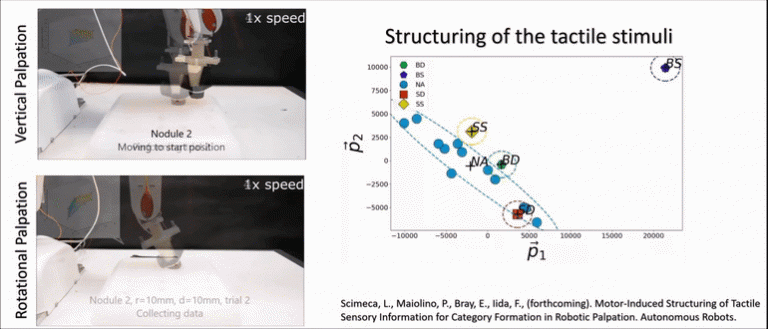

<figure class="plain">
  
</figure>

Robotics and medicine: one of our publications in the journal *Autonomous Robots*,
exploiting the application of machine learning and tactile sensing to aid in the
autonomous detection of abnormal lumps in soft bodies.

In collaboration with Perla Maiolino and Fumiya Iida.
