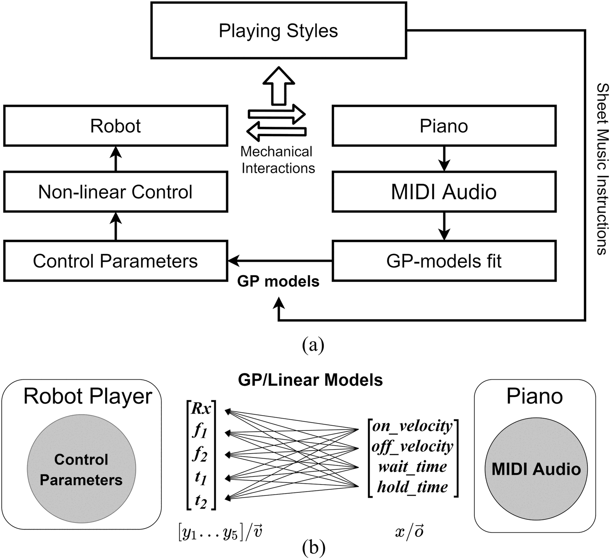



Our paper in *PLOS ONE*, written with Cheryn Ng and Fumiya Iida, proposes a
Gaussian process–based framework that lets a robot use sound feedback to learn to
play the piano in ten different styles.

The piano takes humans years of practice to learn, and much of the skill lies in details
that are hard to see: how fast a key is struck, how long it is held, and how it is
released. These details matter most for the delicate expression of advanced pieces. By
studying the physical interaction between player and instrument, we hoped to gain insight
into human dexterity and adaptability.

Our hypothesis was that the relationship between how a key is pressed and the sound it
produces is highly nonlinear. To test it, we kept the platform minimal: a UR5 robotic arm
with a single elastic, 3D-printed finger, playing a digital piano. The robot performed
3,125 key presses with varied control parameters, while the piano recorded the sound of
each one as MIDI data.

<figure>
  
  <figcaption>(a) The learning loop: the piano's MIDI output is used to fit GP models, which set the robot's control parameters for each playing style. (b) The mapping the models learn. Figure from the paper (CC BY 4.0).</figcaption>
</figure>

From this data, we trained Gaussian process (GP) models for ten playing styles, covering
articulations such as staccato and tenuto, and dynamics from *fortissimo* down to *pppp*.
Comparing the control parameters with the sounds they produced confirmed a strongly
nonlinear relationship, especially for rich expressions such as a wide range of dynamics.
Linear regression models found this relationship difficult and slow to learn, compared
with our GP-based approach.

Finally, we compared the robot with an experienced human pianist playing the same styles.
For some expressions the robot's sound came close to the human's; others will need
further investigation.
