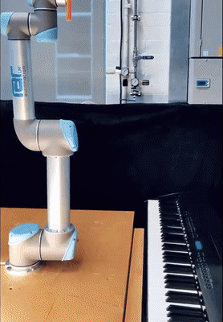

<figure class="plain">
  
</figure>

A robot that can autonomously learn to play piano by mimicking the dynamics of
different human playing styles.

Our publication, in collaboration with Cheryn Ng, in the international journal
*PLOS ONE*, is titled "Gaussian Process inference modelling of dynamic robot control
for expressive piano playing". In the paper we propose a Gaussian-Process-based
mathematical framework for a robot to use sound feedback to autonomously learn how to
play piano according to 10 different play styles.
