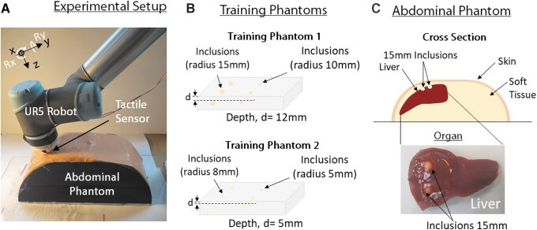

An article published by the University of Cambridge describes part of my work on using
AI and robotics in medicine.

RoboPatient is a collaborative project funded by the EPSRC, bringing together researchers
at the University of Cambridge, Imperial College London, and the University of Oxford. It
asks how advances in soft robotics and tactile sensing can help teach trainee doctors
palpation: examining a patient by feeling the size, texture, and position of organs with
the fingers and hands. Palpation is hard to teach, and usually takes a great deal of
hands-on practice with real patients.

The article describes a first step, published in *Autonomous Robots*. A robotic arm with a
tactile sensor probes a soft silicone phantom organ, and machine learning helps choose the
probing motions that best reveal the hard inclusions hidden inside it, before any labeled
data is needed. I cover that study in
[its own post]().

  <iframe src="https://www.youtube-nocookie.com/embed/34e5d2FeKhk"
          title="Introducing RoboPatient"
          allow="accelerometer; autoplay; clipboard-write; encrypted-media; gyroscope; picture-in-picture"
          allowfullscreen loading="lazy"></iframe>

Read the full article on the
[Cambridge Engineering website](https://www.eng.cam.ac.uk/news/introducing-robopatient-soft-robotics-approach-training-doctors).

## Finding the right touch

We have published part of this work in the robotics journal *Soft Robotics*.
The research article is titled
"[Action Augmentation of Tactile Perception for Soft-Body Palpation](https://www.liebertpub.com/doi/full/10.1089/soro.2020.0129)".
In it, we take a closer look at physical medical examination: we use a
robotic platform and a mathematical framework both to understand and to employ complex
palpation strategies, in order to achieve appropriate sensory perception for robotic
medical diagnosis.

<figure>
  
  <figcaption>The experimental setup, the two training phantoms, and the abdominal phantom with its silicone liver. Figure from the paper (CC BY 4.0).</figcaption>
</figure>

Palpation can reveal signs of conditions as serious as cancer, yet the technique is still
poorly understood, because the interaction between a doctor's hands and soft tissue is so
complex. Our robot palpated two flat training phantoms and a more lifelike abdominal
phantom with a silicone liver inside. Each palpation combined pressing with rotation about
two axes, giving 64 different trajectories to compare.



Using a Bayesian framework for training and classification, we found that telling abnormal
inclusions apart requires complex, multi-axis palpation trajectories, and that this
probabilistic approach can search the robot's large space of possible actions quickly.
The strategies it found could confidently detect inclusions as small as 5 mm in diameter.
Small changes to the trajectory, or to the "patient," noticeably changed performance, so
the best palpation has to be found for each patient, much as doctors adapt their touch.

## What comes next

The next phase of RoboPatient turns to the patient's side of the examination. Working with
Imperial College London, the project will collect data on how palpation feels to the
patient, capturing reactions such as pain, facial expressions, and even verbal cues.
Imperial's soft phantom organ, fitted with sensors, and a robotic face that shows
expressions of pain can then help guide how a doctor performs the examination.
