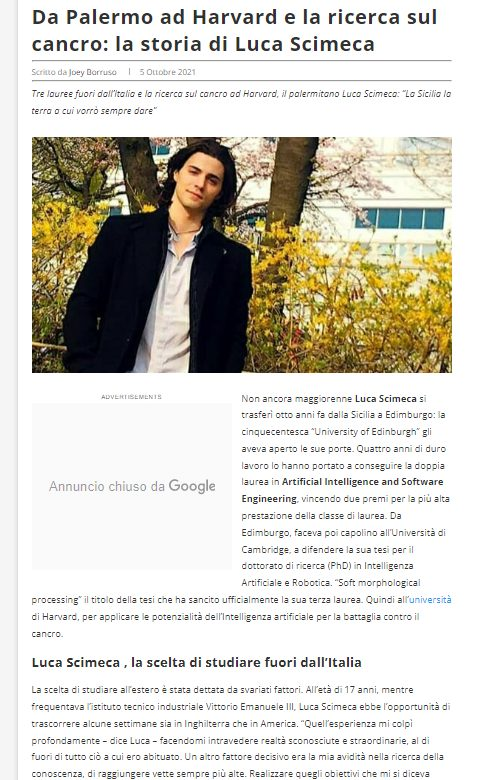

An amazing article by Joey Borruso, telling the story of my journey — starting in
Sicily, Italy, and arriving at Harvard and Dana-Farber to work on machine learning for
cancer research.

<figure class="natural">
  
</figure>

The full article is on
[PalermoLive](https://palermolive.it/ricerca-cancro-luca-scimeca/).
