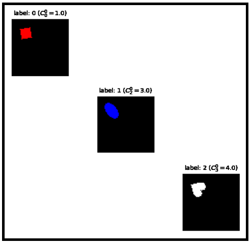
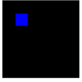
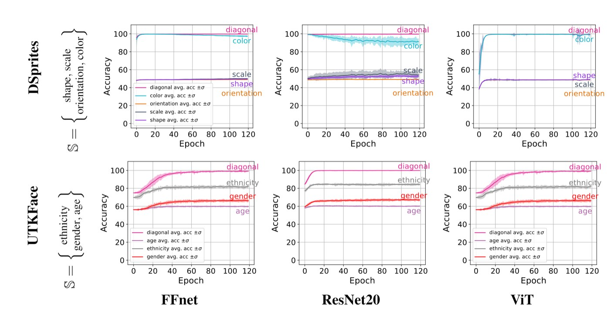
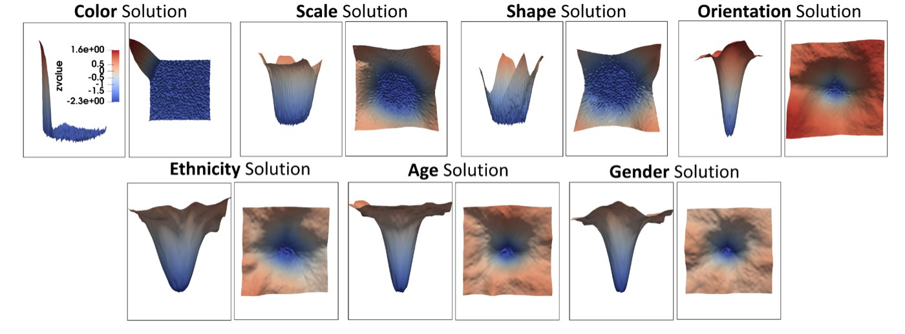
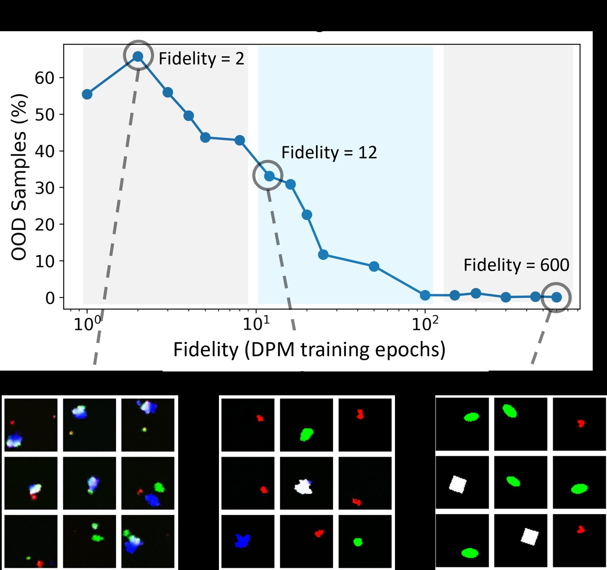
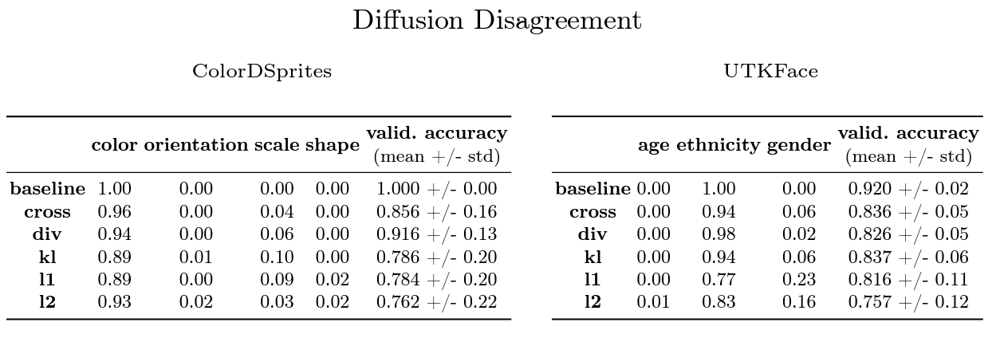

Deep neural networks (DNNs) often rely on easily learned discriminatory features, or
*cues*, that are not essential to the problem at hand — a phenomenon known as
**shortcut learning**. A DNN may recognize ducks based on the typical background
scenery of lakes or streams rather than on the ducks themselves. This shortcut bias
limits generalization, particularly in harder test scenarios where the shortcuts are
no longer valid.

To investigate the shortcut learning tendencies of deep models we introduce a new
training setup: the **Wisconsin Card Sorting Test for Machine Learners (WCST-ML)**.

## The Wisconsin Card Sorting Test for Machine Learners

We envision a simple, yet powerful, setting. Imagine you were given this limited set of
images and labels:

<figure class="natural">
  
  <figcaption>The training set: every image is fully correlated across at least two high-level cues.</figcaption>
</figure>

You are then asked to provide a label for the following image. You can choose between
0, 1 or 2, according to your understanding of the task:

<figure class="plain natural">
  
  <figcaption>The query: an unseen combination of features. What would you choose?</figcaption>
</figure>

The problem with this question lies in its *ill-defined* nature. The images and labels
in the training matrix are fully correlated with respect to at least two interpretable high-level cues — for example shape and color. At training time the classification
task can be solved perfectly by relying on either feature; at test time, an image
showing an unseen feature combination requires generalization.

If a human were to solve this task, several factors could play a role in the final
decision. Prior knowledge about the world, the task, or even other related tasks might
influence our beliefs about the underlying task to solve — yes, in a Bayesian sense.
Ideally we would form a set of hypotheses (hopefully containing both shape and color as alternatives), and make a choice given our prior and our observations, updating as
we see more data. The important part is that the choice we make is *informative of our
priors*, and of our biases. Absent a significantly different prior among participants,
labeling the image 0 would display a bias toward shape, while labeling it 1 would
showcase a color-based task logic.

During training, deep learning models have their own biases, and have often been
observed to collapse to easy-to-learn cues. Similarly to the degenerate classification
case above, available datasets typically underspecify the task to be solved, and data
is hardly ever comprehensive enough to fully constrain decision-making.

## Models agree on which shortcuts to take

In our work we run extensive experiments to observe how different architectures react
when put through a similarly underspecified visual discrimination task. Our first
interesting finding is that, despite the different inductive biases induced by
different architectures, we observe largely similar behavior across models. Models
reliably prefer certain cues — like color — more than others. Color is a
particularly easy cue to fit in the simple example above, since we have some intuition
about how it might be solved by something akin to channel selection in the input space.

Experiments on more complex datasets, such as UTKFace, show that cues such as
ethnicity, gender, and age also rank similarly across architectures, exposing
potentially sensitive biases when performing inference without appropriate measures or
human-in-the-loop solutions.

<figure>
  
  <figcaption>Cue preference is remarkably consistent across architectures.</figcaption>
</figure>

Interestingly, we find these biases can be explained by the loss
landscape: the set of solutions biased toward the preferred cues occupies a far greater
volume — and tends to be flatter — than those corresponding to the less-preferred cues.

<figure>
  
  <figcaption>Solutions that rely on preferred cues occupy larger, flatter basins.</figcaption>
</figure>

We call this fully correlated test WCST-ML, and propose a simple framework for
exploring any such biases. As long as a dataset has multiple labels for each input, and
enough elements to generate a fully correlated dataset, WCST-ML should be readily
applicable. The ICLR paper goes into much more depth, showing what
these shortcut biases look like during training and how they might be avoided. These findings shed light on shortcut learning in deep models, and
emphasize the importance of solutions such as active human intervention to remove model
biases that may cause negative societal impacts.

## Mitigating the bias with diffusion counterfactuals

In follow-up work, we propose a solution based on **ensemble diversification**. An
effective approximation to the Bayesian ideal above is to let an ensemble of models
entertain a range of diverse hypotheses while observing the degenerate training data.
The diversity must be *functional*, and is therefore not trivial to enforce.

We propose a method based on synthetic counterfactuals sampled from an appropriately
trained Diffusion Probabilistic Model (DPM). We find that DPMs pass through a stage of training
in which they are more likely to produce samples with novel feature combinations — an
*originative* stage.

<figure>
  
  <figcaption>Across training, DPMs pass through a stage where novel feature combinations are more likely.</figcaption>
</figure>

Even when lacking fidelity, these samples can be leveraged directly for ensemble
diversification through model disagreement, enforcing functional diversity across
models.

In the table below you can see the fraction of models that attend to a given cue (out
of an ensemble of 100) when trained without diversification — the baseline case above —
and when trained with our diversification method.

<figure>
  
  <figcaption>Diversification shifts models toward non-shortcut cues, without additional data collection.</figcaption>
</figure>

This demonstrates that we can get models to attend to non-shortcut cues, even without
the need for expensive additional data collection.
