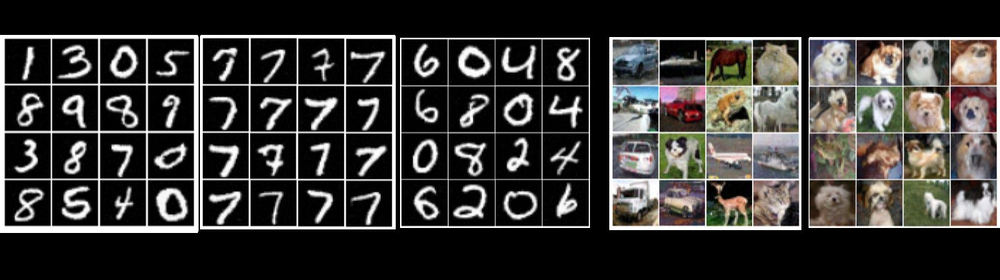
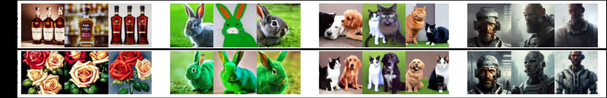

In the ever-evolving landscape of artificial intelligence, diffusion models have
emerged as a powerful tool for generating high-quality data across domains such as
images, text and even action spaces. But what happens when we need these models not
just to generate, but to *adapt to specific constraints*? We tackle exactly this
problem in our paper
"[Amortizing Intractable Inference in Diffusion Models for Vision, Language, and Control](https://arxiv.org/abs/2405.20971)",
where we propose **Relative Trajectory Balance (RTB)** — an asymptotically unbiased
training objective for diffusion models that sample from posterior distributions
under a diffusion model prior.

## Tackling the intractable: why posterior inference matters

Diffusion models generate data by transforming noise through a series of steps.
In real-world applications, however, we often need them to conform to certain
constraints — think of generating an image with specific features, or producing text
that adheres to a given context. This leads us to the problem of *posterior
inference*, where we want to sample data that fits both the original prior
distribution and the additional constraints. The catch? This posterior inference is
typically intractable.

## Relative Trajectory Balance

At its core, RTB is about being able to fine-tune a diffusion model prior into a
posterior model, and sample according to the posterior distribution of interest.
Ideally the posterior model should not drift too far from the prior — we want the
samples to remain plausible under the original prior — but it should nonetheless
change appropriately to capture the posterior of interest.

When tackling the posterior sampling problem, the goal is to sample from a posterior
distribution $p_{\text{post}}(\mathbf{x}) \propto p_\theta(\mathbf{x})\, r(\mathbf{x})$,
where $p_\theta(\mathbf{x})$ is our diffusion model prior and $r(\mathbf{x})$ is the
constraint. Importantly, $r(\mathbf{x})$ does not need to be differentiable: it can be
a measurement, a reward from another model, a human preference — anything, really.

Our RTB objective introduces a constraint that enforces the correct relationship
between the prior and the posterior processes:

$$
\mathcal{L}_{RTB}(\mathbf{x}_0 \rightarrow \mathbf{x}_{\Delta t} \rightarrow \dots \rightarrow \mathbf{x}_1; \phi)
:= \log\left(\frac{Z_{\phi} \cdot p_\phi^{post}(\mathbf{x}_0, \mathbf{x}_{\Delta t}, \dots, \mathbf{x}_1)}{r(\mathbf{x}_1)\, p_{\theta}(\mathbf{x}_0, \mathbf{x}_{\Delta t}, \dots, \mathbf{x}_1)}\right)^2
$$

This ensures that the likelihood of the denoising trajectory under the posterior model
$p_\phi^{post}$ stays close to the likelihood of the same trajectory under the prior
$p_{\theta}$, while learning the scalar $Z_{\phi}$ (in log scale, for numerical
stability) and sampling proportionally to $p_\theta(\mathbf{x})\,r(\mathbf{x})$. Thanks
to its design, the advantage of RTB lies in its ability to achieve *unbiased* posterior
sampling — proof in the [paper](https://arxiv.org/abs/2405.20971).

## Highlight results

To show the effectiveness of RTB we provide a diverse set of empirical results across
multiple domains. Some highlights:

In **vision**, RTB applied to image generation achieves state-of-the-art results,
improving on classifier guidance and RL-based baselines in both the diversity of the
generated posterior samples and their closeness to the true posterior. Below is an
example of fine-tuning an unconditional diffusion prior.

<figure>
  
  <figcaption>Class-conditional samples obtained by fine-tuning an unconditional diffusion prior with RTB.</figcaption>
</figure>

In **stable diffusion**, we can fine-tune a large text-to-image model to achieve high
scores according to human preference, on par with state-of-the-art methods.

<figure>
  
  <figcaption>Fine-tuning a large text-to-image model toward human preference with RTB.</figcaption>
</figure>

In **language**, we show we can fine-tune a posterior over a discrete language
diffusion model prior to perform coherent posterior sampling for text infilling.

In reinforcement learning **control** tasks, we report state-of-the-art results when
training a posterior behaviour policy from a diffusion behavioural prior, achieving
comparable or better results than other recent methods.

## Conclusion

Relative Trajectory Balance is a flexible objective that allows efficient and unbiased
sampling from a posterior distribution, given a diffusion prior and a reward or
likelihood. The empirical results across vision, language and control underscore the
potential of RTB to set new benchmarks across AI applications. Whether you are diving
into research or developing practical solutions, the advances presented here are poised
to change how we generate and refine data.
